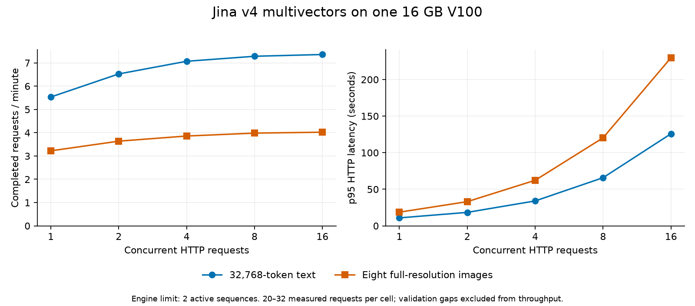

# Two 16 GB V100 campaign — 2026-10-23

**The runtime/capacity gate passed for all five pinned models.** The final
`volta-2` campaign completed **4,474 checked inference requests with zero HTTP
or declared quality-gate failures**, including validated sweep warmups. All
five services remained resident during the combined loads and bursts. No
context, attention window, image limit, or recording was shortened.

Use GPU 0 for Snowflake, BGE, FP32 EmbeddingGemma, and native-vLLM `bbyn-v2`;
reserve GPU 1 for Jina v4 retrieval multivectors. The practical default is the
validated **30 total requests/minute** mix. Workload size matters: the largest
Jina payloads have much lower capacity than short text.

## Exact deployment

| GPU | model | precision | context | active engine sequences |
| --- | --- | --- | ---: | ---: |
| 0 | Snowflake Arctic Embed L v2.0 | FP16 | 8192 | 4 |
| 0 | BGE reranker v2-m3 | FP16 | 8192 combined query/document tokens | 4 |
| 0 | EmbeddingGemma 300M | FP32, native sliding attention | 2048 | 4 |
| 0 | `mlmlaziz/bbyn-v2` | FP16, native vLLM | 448 decoder tokens per chunk | 4 |
| 1 | Jina v4 baked retrieval checkpoint | FP16 backbone, FP32 projection | 32768; up to eight images | 2 |

Revisions are pinned in [models.json](models.json). All processes use TP1.
Whisper reserves 2 GiB of KV cache; Jina reserves 1.5 GiB. Jina retains
`max_pixels=3211264`, full token-vector output, and its 32768-token batch budget.
Use the [Compose override](compose.override.yaml) with the existing layout as
shown in [README.md](README.md). ASR requires explicit `language=en` or
`language=ar` and `response_format=json`.

The image actually booted on Vast and exercised by every serving process was
`sha256:5a1adb39d075eff377372c877a36bef30ecc3f82896633a15036405673d7e77b`.
It contains vLLM 0.32.0+cu126, PyTorch 2.13.0+cu126, Transformers 5.19.0,
Triton 3.7.1, and Jina plugin 0.1.1. The ASR entrypoint executes native vLLM.
The reused base still contains the earlier CTranslate2 packages; they were
not the ASR execution path in this campaign.

Keep the image's CUDA 12.6 `ptxas`, `VLLM_USE_V2_MODEL_RUNNER=0`,
`VLLM_USE_FLASHINFER_SAMPLER=0`, `OMP_NUM_THREADS=4`, and
`PYTORCH_ALLOC_CONF=expandable_segments:True`. Jina's bounded-cache YAML is a
required deployment override. [Runtime fingerprints](results/runtime.json)
match upstream v0.32.0 for the checked model, parser, and cache source files.
All eight [weight files](results/weight-hashes.json) matched their pinned hashes.

## Hardware and memory

The final venue was one verified machine exposing two **V100-SXM2-16GB** cards,
SM70, 16384 MiB each, driver 580.173.02. Its measured interconnect was **NODE,
without NVLink**. The host had an AMD EPYC 7352, 24 effective CPU cores
(48 logical CPUs visible), and approximately 64 GB RAM. Results describe this
anonymous capability profile and do not identify a deployment or owner.

Both GPUs passed a 12 GiB allocation/fill probe, matrix checks, the native vLLM
RMSNorm extension, and efficient SDPA. During the accepted mixed loads and
measured bursts, sampled peaks were:

| resource | observed peak |
| --- | ---: |
| GPU 0 VRAM | 11049 MiB / 10.79 GiB |
| GPU 1 VRAM | 15007 MiB / 14.66 GiB |
| GPU utilization | 100% on each card |
| serving-process host PSS | 18.13 GiB |

GPU samples were taken every second; host samples every five seconds. These
are sampled footprints. Host PSS covers the serving UID and excludes the
benchmark client, OS page cache, and unrelated processes. Detailed power,
utilization, temperature, clocks, and CPU samples are summarized in the CSV.
No allocator-OOM or out-of-memory messages appeared in the final venue's
native serving logs.

A paired development check explains the Jina cache setting: automatic cache
allocation reached 15926 MiB during startup/warmup and logged 170 allocator
retry warnings. The 1.5 GiB cache reached 15006 MiB and logged none, with full
context and eight-image warmup intact. Those measurements used the same
intermediate machine; its timing is not substituted for the final benchmarks.

## Full-payload latency

These are warmed, concurrency-1 HTTP measurements, including response-body
reception. GPU 0 models were measured one at a time while Jina ran on GPU 1;
host resources were shared. Each row has 20 measured requests.

| workload | payload | median seconds | p95 seconds |
| --- | --- | ---: | ---: |
| Snowflake | 8192 tokens | 1.552 | 1.554 |
| Snowflake | 8 inputs, 22302 total tokens | 3.577 | 3.600 |
| BGE | 8192-token pair | 1.555 | 1.558 |
| BGE | 32 candidates, 9572 total tokens | 0.320 | 0.349 |
| EmbeddingGemma | 2048 tokens | 0.115 | 0.116 |
| EmbeddingGemma | 8 inputs, 6947 total tokens | 0.373 | 0.399 |
| bbyn-v2 English | 9.36-second clip | 0.981 | 1.008 |
| bbyn-v2 English | 190.06-second recording | 5.558 | 5.634 |
| bbyn-v2 Arabic | 10.80-second clip | 2.226 | 2.257 |
| bbyn-v2 Arabic | 189.29-second recording | 10.806 | 10.982 |
| Jina multivector | 32768 tokens | 10.836 | 10.884 |
| Jina multivector | 8 full-resolution images | 18.624 | 18.695 |

The long ASR examples correspond to about 34.2× real time for English and
17.5× for Arabic at concurrency 1. These are fixture-specific measurements;
speech content and decoder token count affect latency.

## Jina concurrency and capacity

All six text/image shapes passed at client concurrency 1/2/4/8/16. A further
147 checked requests mixed different shapes concurrently. Every image request
received fresh UUIDs to force vision work. Text inputs were strings, and
reported token counts matched complete inputs throughout.

| Jina payload | C1 requests/minute | C16 requests/minute | C16 median seconds | C16 p95 seconds |
| --- | ---: | ---: | ---: | ---: |
| 128 tokens | 979.58 | 2572.35 | 0.230 | 0.359 |
| 8192 tokens | 35.79 | 61.68 | 9.465 | 15.149 |
| 32768 tokens | 5.54 | 7.36 | 69.226 | 125.860 |
| 1 image | 33.19 | 46.17 | 12.194 | 20.208 |
| 2 images | 16.22 | 21.95 | 25.776 | 42.406 |
| 8 images | 3.22 | 4.02 | 127.731 | 229.824 |

Client concurrency includes queued requests; the engine still admits at most
two active sequences. For large interactive requests, start with one or two
in flight and bound the upstream queue. Additional concurrency contributes
little throughput at the largest shapes. A workload of ten eight-image
requests/minute exceeds this measured card's capacity. Use the primary stack
for overflow or schedule bulk indexing against the measured capacity.

Full 32768-token and eight-image responses contain roughly 85–87 MB of float
JSON. Measurements used loopback HTTP; production network transfer and client
postprocessing must be budgeted separately.

## All five models under load

The rates below are totals across five services, with equal request counts per
service. Inputs rotate through short, medium, full-context, and batched text;
Jina uses all six text/image shapes; ASR uses both languages and short/long clips.

| offered total rate | duration | checked requests | steady completed rate | final drain | failures |
| --- | ---: | ---: | ---: | ---: | ---: |
| 10/min | 5 min | 50 | 10/min | 0 s | 0 |
| 30/min | 20 min | 600 | 30/min | 18.61 s | 0 |
| 60/min | 5 min | 300 | 59.67/min | 21.12 s | 0 |

Steady rates count completions after the first two minutes and before the
scheduled window ends. Drain includes finishing the final in-flight requests;
it is not by itself evidence of a growing backlog. At 60/minute, maximum
client launch delay reached 2.20 seconds, so the offered schedule had measurable
client jitter. Treat that short run as stress evidence rather than an SLA.

| service | 30/min mix median | 30/min mix p95 | 60/min mix median | 60/min mix p95 |
| --- | ---: | ---: | ---: | ---: |
| Snowflake | 1.015 s | 3.908 s | 2.256 s | 7.619 s |
| BGE | 0.549 s | 2.917 s | 0.695 s | 4.300 s |
| EmbeddingGemma | 0.110 s | 0.637 s | 0.340 s | 1.309 s |
| bbyn-v2 | 2.415 s | 11.198 s | 2.889 s | 12.510 s |
| Jina v4 | 3.669 s | 18.479 s | 11.339 s | 19.997 s |

Full-payload bursts at 5/10/20 simultaneous requests also passed. The largest
burst had a 19.37-second median, 48.03-second p95, and 61.46-second maximum.
Each service received full inputs, including the 32K-equivalent eight-image
Jina payload and a three-minute Arabic recording. This deliberately heavy mix
completed about 19.4 requests/minute in the concurrency-20 burst measurement;
its capacity should be distinguished from the rotating 30/60-request mixes.

## Quality and its limits

The complete 295-case gate passed before the sweeps and again after fresh
model-process starts. Twelve additional WAV/MP3/AAC checks covered both
languages at short and three-minute durations against FP32 inference of the
same decoded waveforms; six preliminary codec checks also passed. All
performance responses were checked against references. Server token accounting
matched every successful pooling/reranking input, and full output shapes were
validated.

Snowflake's minimum reference cosine was 0.99999845. EmbeddingGemma's was
0.99999998. BGE's maximum absolute score difference was 0.00027324, with the
expected top-ranked document retained.

The FLEURS validation short corpus contains 128 clips per language. The following results
were identical in the initial and fresh-start gates:

| language | native V100 WER | FP32 WER | native V100 CER | FP32 CER | normalized transcripts equal |
| --- | ---: | ---: | ---: | ---: | ---: |
| English | 7.633% | 7.633% | 4.017% | 4.017% | 128/128 |
| Arabic | 49.956% | 49.912% | 12.863% | 12.831% | 126/128 |

Arabic has one additional aggregate word error versus FP32, a 0.044 percentage
point difference. Its high absolute WER remains a property of this model/corpus
comparison; matching FP32 does not establish production-domain recognition
accuracy. Long recordings and their shifted boundaries passed their separate
error gates. They combine source utterances excluded from the short corpus and
are not additional independent short-corpus observations. One quiet English
clip remained empty in both inference paths; that error is included in WER.
Silence checks passed.

**Jina passes the declared mean-cosine/ranking gates, with important per-token
limits.** The worst mean cosine was 0.993115 for eight images. In that case,
445 of 32277 token vectors had cosine below 0.9; three were negative. The first
percentile was 0.848 and the minimum −0.191. No outlier vectors were discarded.

The canonical reference uses original FP32 weights/adapters; serving uses the
pinned baked retrieval checkpoint and an FP16 backbone. This comparison
includes conversion, backend, and precision differences and does not isolate
a V100-specific cause. The three tested six-document rankings agreed when
query and document vectors both came from the serving stack. Supplementary
cross-stack comparisons retained top-1 in 9/9 cases, but full ordering agreed
in 8/9: one second/third-place pair swapped with an FP32 query and served
documents. See [the numerical sensitivity record](results/jina-fidelity.json).

Use a consistent pinned Jina stack for index and query generation. These small
reference/ranking probes do not certify relevance on an application's labeled
retrieval dataset, or guarantee that mixing an existing index with another
inference precision leaves every ranking unchanged.

## Artifact, security, and reproducibility

The tested image was exported as a 4,575,692,152-byte Docker archive, verified,
and restored to the same image digest. Its archive SHA-256 is
`e467aa4b44e0fe82f6fb213eca91100a036da6df6dd9da0963eee43f20c53e4d`.
The archive is under ignored `runs/v100-full/image/`; the
[receipt](results/image.json) and deployment commands are retained here.

All five GPU services passed authenticated model identity and health checks,
rejected missing/wrong keys, and ran as UID 10001. A separate CPU container
check verified read-only root/model mounts, writable temporary/compiler-cache
paths, dropped capabilities, and `no-new-privileges`. Full GPU Docker Compose
isolation was not exercised inside the Vast container.

The [base security assessment](../v100-modern/SECURITY.md) and unfiltered scans
remain relevant to the reused package stack. **The final deployed digest still
requires Prisma policy approval.** No Prisma endpoint or command was available;
this campaign does not claim a Prisma verdict.

[benchmarks.csv](results/benchmarks.csv) contains 132 measurement summaries,
including throughput in requests/items/tokens/images/audio seconds, latency,
resource samples, and client delay. [quality.csv](results/quality.csv) contains
608 quality rows. [provenance.json](results/provenance.json) binds each phase's
parameters, fixtures, configuration, harness, and raw request records.
[asr-corpus.json](results/asr-corpus.json) keeps the two corpus runs separate.
The README gives reproduction commands.

Sweep cells include an excluded validated warmup cohort; throughput excludes
validation gaps. HTTP latency ends after body reception. p95 requires at least
20 samples and p99 at least 100; these small constant-input samples are not
production latency guarantees. Model caches and compiler caches stayed warm
across process restarts. No production SLA or exact traffic distribution was
provided.

## Rental lifecycle

All rentals were development rentals with an external watchdog and a cost cap.
The first image delivery was abandoned after slow progress. A second offer
expired at its advertised end time; that selection missed the required lifetime
check. Its evidence was recovered and the full campaign was rerun on the final
verified pair. Future selection explicitly requires an end date beyond the
watchdog deadline plus an hour.

An attempted model-cache migration exposed a stale overlay view in the running
container. The same replacement container was restarted, transport tooling was
repaired, and missing pinned files were fetched directly. BGE/Gemma cache data
was retained; all weight hashes were checked before inference. No rental was
destroyed to work around a model/configuration failure.

All three rentals have provider-confirmed teardown and completed watchdog
cleanup. GPU memory was zero after the model groups stopped. The conservative
full-hourly-rate elapsed bound is **about $2.10 excluding transfer**, including loading
and stopped periods that may be billed differently. The final rental rate was
$0.41259/hour. [Lifecycle](results/lifecycle.json) and
[staging](results/staging.json) receipts retain elapsed time, rates, logical
transfer sizes, and cache reuse; the bound is not a provider invoice.
